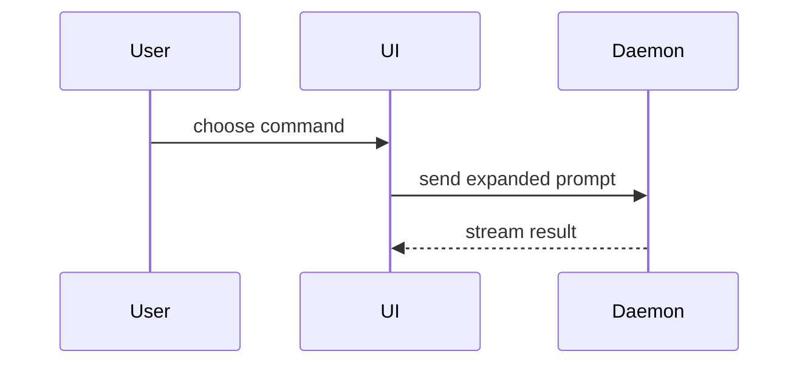

<!-- From humanlayer/humanlayer at 3a8dd2d, Apache-2.0. Modified: renamed with the rpi- prefix, inlined the reference templates and the show-me guidance they link to, removed the cloud permalink section and the HumanLayer sidebar, sharing and hook text, .humanlayer/tasks paths now ask Carlos where to save, agents and next command point at the rpi- names, replaced em dashes. -->

# Design Discussion Phase

You are now in the Design Discussion phase. Based on the research findings and the user's change request, work with them to make design decisions.

## Steps to follow after receiving the user's request

1. **Read the files in the task folder and any mentioned files immediately and FULLY**:
   - Ask Carlos which folder holds this task's documents, unless it was already named, then run `ls -La` on it to find all related documents. Do NOT use the Grep or Glob tools, or `ls -l` as the directory may be a symlink.\
   - Ticket files (e.g., `ticket.md` or `task.md` in that folder)
   - Research documents (e.g. `NN-research-DESCRIPTION.md` in that folder)
   - **DO NOT read research questions documents** - research questions are inputs to the research phase only.
   - **IMPORTANT**: Use the Read tool WITHOUT limit/offset parameters to read entire files, never read files partially - if a file is mentioned, read it completely
   - do not spawn sub-tasks before reading these files yourself in the main context

2. **Check for related task content**:
   - if a path to a task folder is mentioned, use Bash(`ls -La <that folder>`)
   - **IMPORTANT** DO NOT USE search or glob or grep, or `ls -l` (lowercase L), as the task folder may be a symlink and those tools don't traverse symlinks
   - read all relevant files in the task directory to fully understand the work so far, excluding research questions documents

3. **Optional - Spawn parallel sub-tasks for comprehensive research**:
   - If not clear from the research, spawn sub-tasks to research different aspects concurrently
   - Create multiple Agent() calls to research different aspects concurrently
   - Use the right agent for each type of research:

   **For deeper investigation:**
   - **rpi-codebase-locator** - To find more specific files (e.g., "find all files that handle [specific component]")
   - **rpi-codebase-analyzer** - To understand implementation details (e.g., "analyze how [system] works")
   - **rpi-codebase-pattern-finder** - To find similar implementation patterns we can model after

   Each agent knows how to:
   - Find the right files and code patterns
   - Identify conventions and patterns to follow
   - Look for integration points and dependencies
   - Return specific file:line references
   - Find tests and examples

<important if="the user asks you to find how things work or add detail about existing functionality">
  prefer to use an initial pass with one or more Agent() calls before reading files yourself
  <else if="the user gives straightforward feedback that doesn't require loading more codebase context">
      skip Agent() calls if you already have the context
  </else>
</important>

4. **Use the design discussion template and visual guidance**

Use "Design discussion template" and "Visual guidance (show-me)" below.

- Follow the `show-me` guidance throughout the design discussion.
- Use the smallest set of visual views needed to make the current state, proposed end state, and key design choices clear.
- Place each visual next to the short text it supports. Do not add visuals that do not help the user make a design decision.

5. **Write the design discussion**: ask Carlos where to save it, and save it only there
   - Format: `NN-design-discussion-DESCRIPTION.md` where NN is a zero-padded chronological index and DESCRIPTION is a 2-4 word kebab-case slug
   - **Chronological indexing**: `ls` the folder Carlos named, find the highest existing NN- prefix, and use the next number. First document = `01-`, second = `02-`, etc.
   - Examples:
     - With ticket: `03-design-discussion-parent-child-tracking.md`
     - Without ticket: `03-design-discussion-error-handling.md`

<content_guidance>
**Outline High-level product spec** - Current state, desired end state, what we're not doing in terms of user experience or functionality

**Outline the proposed end state architecture** - Use focused before-and-after diagrams, trees, pseudocode, or other views from the `show-me` guidance. Prefer `diff` blocks when the key point is what changes, and show the full target shape when it makes ownership or order clearer.

**Discuss design decisions**
   - For each major design choice, present options with pros/cons
   - Make recommendations based on codebase conventions
   - If the research surfaced testing patterns for the components being changed, include a brief testing approach (e.g. "follow the existing unit test pattern in `__tests__/foo.test.ts`")

**IMPORTANT: All design questions must be written in the OPEN state**
   - Put ALL questions under "Design Questions", NOT under "Resolved Design Questions"
   - You may recommend an option, but you must NOT resolve or close a question yourself
   - Only the user can resolve a design question, through explicit feedback or approval
   - The "Resolved Design Questions" section should be empty in the initial document
   - Do NOT auto-resolve questions even if the answer seems obvious from the research

**Resolving questions after user feedback**
   - When the user provides a clear answer (e.g. "for X we should do Y"), move the question to "Resolved Design Questions"
   - They don't need to say "resolve" explicitly. Any clear indication of a decision counts
   - Record the final decision with rationale
   - Record the options that were considered but not chosen, with brief rationale for why they were discarded

**Present patterns to follow** 
   - Identify existing patterns in the codebase that should be followed
   - Include file locations and multiline code snippets showing the pattern

</content_guidance>

6. **Pick the final output template**

Use "Final answer template" below.

If every design question in the document has been resolved, use "Final answer template (all questions resolved)" instead.

7. Respond following the selected template exactly. Do not include a summary or other information.

<guidance>
## Markdown Formatting

When writing markdown files that contain code blocks showing other markdown (like README examples or SKILL.md templates), use 4 backticks (````) for the outer fence so inner 3-backtick code blocks don't prematurely close it:

````markdown
# Example README
## Installation
```bash
npm install example
```
````

## Document Precedence

When documents conflict, the most recent document wins:
**design discussion > research > ticket**

Decisions made during the design discussion supersede the original ticket description.
The ticket provides the initial request; the design discussion refines and finalizes the approach.
</guidance>

## Design discussion template

````markdown
---
task: eng-xxxx-description
type: design-discussion
repo: [current repository]
branch: [current branch name]
sha: [result of git rev-parse HEAD]
---

### Summary of change request

[summary of what the user wants to build based on their request and the ticket]

### Current State

- [what the user sees or experiences today (product behavior, UX gaps, user pain points), with no file paths or function names]
- ..
- ..

### Desired End State

- [what will be true when this work is done]
- [user story, problems that will be solved, new things a user can do]
- ..

### What we're not doing

- [things that are out of scope]
- ..

### Proposed End State Architecture

[concise outline of the proposed end state architecture with description, diagrams, psuedocode, etc according to show-me]

### Design Questions

#### [title first question]

[the design question]

- Option A: ...
[optional: short code snippet, mermaid diagram, pseudocode, etc]
- Option B: ...
[optional: short code snippet, mermaid diagram, pseudocode, etc]
- ..

Reccomendation: [....]

#### [title second design question]

...


### Resolved Design Questions

#### [title resolved question]

[option chosen] - [rationale] - [pattern to follow or psuedocode, mermaid diagram, etc]

[brief summary of options not chosen with rationale]


#### [ title second resolved question]

...


### Patterns to follow

These show the patterns found in the existing codebase that will be followed to implement the proposed end state architecture.

#### [title First pattern from research]

[summary of the pattern] - e.g. [path/to/file]

```
[succint code examples from existing codebase demonstrating the pattern]
```

```
[succint code examples from proposed end state architecture demonstrating the pattern]
```

#### [title Second pattern from the research]

...
````

## Visual guidance (show-me)

Help the user understand the current topic of conversation visually. Skip the preamble and keep prose brief. Pick the smallest view that makes the key point clear.

- Show logic or an algorithm as pseudocode:

```text
on(save)
  if content is unchanged
    return cached result
  write new content
  return fresh result
```

- Show runtime control flow as a call tree:

```text
submitForm
  createSession
    persistPrompt
    launchAgent
  navigateToSession
```

- Show UI structure as a component tree, including state and module boundaries that matter:

```tsx
<SessionPage> (apps/example/src/routes/session.tsx)
  useSessionEvents()
  <SessionToolbar>
    <RunSkillButton> (packages/ui)
```

- Show file responsibility or a broad refactor as a shallow file tree:

```text
src/
├── commands/       # parses user actions
├── sessions/       # owns session state
└── transport/      # sends API requests
```

- Show component interaction, control flow, or data flow with Mermaid:



- Use `diff` when the point is what changes and the surrounding shape already exists. Match the diff shape to the topic.

For a component change:

```diff
 <SessionPage>
   useSessionEvents()
   <SessionToolbar>
+    <RunSkillButton />
   <SessionTimeline>
+    <SkillResultCard />
```

For a file-layout change:

```diff
 src/
 ├── commands/
+│   └── show-me.ts       # expands the slash command
 ├── sessions/
-└── transport.ts
+└── transport/
+    ├── client.ts
+    └── stream.ts
```

For a call-tree or call-stack change:

```diff
 submitForm
   createSession
     persistPrompt
+    expandSkillMention
     launchAgent
-  navigateToSession
+  navigateToSession
+    subscribeToEvents
```

For a state or control-flow change:

```diff
 on(save)
-  write content
+  if content is unchanged
+    return cached result
+  write new content
+  invalidate cache
```

- Show the whole block when most of it is new, when omitted context would hide ownership or order, or when the user needs a copyable target shape:

```ts
function expandSkill(command: string): string {
  const skillName = command.slice(1)
  return `use the ${skillName} skill`
}
```

- For a visual UI, layout, state comparison, or concept too dense for Mermaid, create one focused HTML file, for example `show-me-{description}.html`. Match the product's colors, type, spacing, and components; use real labels and data; support desktop and mobile. Ask Carlos where to save it, save it only there, then give Carlos its path.

- Place each visual next to the short text it supports. Keep only the calls, files, props, states, and boundaries needed to answer the user's current question.

## Final answer template

````markdown
## Next Steps

The design document has been created!

It is saved at `[path to the design discussion document]`.

**You should carefully review this document**:
- Ensure the current state and desired end state are correct
- Read the design questions carefully, and work back and forth with me to answer them. 
- Ensure that critical patterns were captured in the document. Ask me to remove any which are incorrect or out-of-date. This is your chance to decide which patterns the implementation follows!

You can also ask me to add more detail, code snippets, pseudo-code, or mermaid diagrams.

We should resolve all design questions in the document before proceeding to the next phase.
````

## Final answer template (all questions resolved)

````markdown
### Next Steps

All questions in the design document have been resolved. At this point, we can proceed to the outline phase and create an outline of the implementation work.

To do this, create a new session with the following command:
```text
/rpi-create-structure-outline [path to the task folder]
```

---

The design document is saved at `[path to the design discussion document]`.
````
