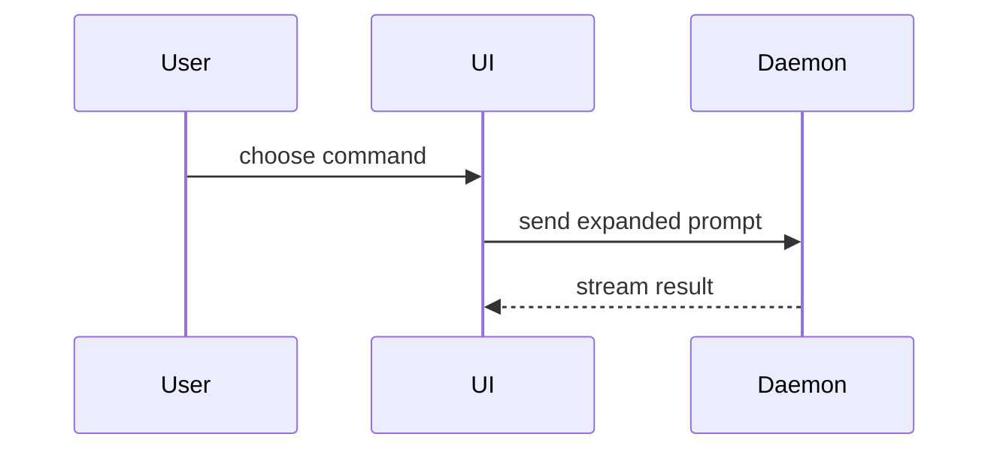

<!-- From humanlayer/humanlayer at 3a8dd2d, Apache-2.0. Modified: renamed with the rpi- prefix, inlined the reference templates and the show-me guidance they link to, removed the cloud permalink section and the HumanLayer sidebar and sharing text, dropped the worktree check and the setup-worktree suggestion, .humanlayer/tasks paths now ask Carlos where to save, agents point at the rpi- names, the next step is rpi-implement-plan, replaced an em dash. -->

# Create Structure Outline

You are creating a phased implementation plan based on research findings and design decisions.

## Input

- If only a directory is provided, list it: `ls -La <that directory>`. Do NOT use grep or glob or `ls` or `ls -l`, as the directory may be a symlink.
- If not directory is provided, you should ask the user which folder holds this task's documents, or what artifacts they would like for you to create the outline from.

## Steps

1. **Read all input documents FULLY**:
   - Use Read tool WITHOUT limit/offset to read the research document
   - Understand the current state of the codebase from research findings
   - Review all design decisions and patterns to follow
   - **DO NOT read research questions documents** - research questions are inputs to the research phase only. Use the completed research document instead.

2. **Check for related task content**:
   - If a path to a task folder is mentioned, use `ls -La <that folder>`
   - Read all files in the task directory except research questions documents
   - Read relevant files mentioned in the task files

3. **Spawn sub-agents for follow-up research if necessary**:

   **For deeper investigation:**
   - **rpi-codebase-locator**: Find additional files if needed
   - **rpi-codebase-analyzer**: Deep-dive on specific implementations
   - **rpi-codebase-pattern-finder**: Find more examples of patterns
   - **rpi-web-search-researcher**: Research external best practices

   Do not run agents in the background - FOREGROUND AGENTS ONLY.

4. **Read the visual guidance, then create a phased implementation plan**:
   - Before creating the outline, read "Visual guidance (show-me)" below
   - Use the smallest set of visual views needed for each phase instead of a list of files and changes
   - Tell the story of each phase in the order that makes it easiest to understand; show files first when ownership gives the needed context, or establish key data structures, SQL tables, or API contracts first when they explain the rest of the change
   - Treat every visual view and subheading as optional. Choose and order them based on the change rather than a fixed template
   - It should be written as one human would write to another
   - Place a short description between visual views so the outline explains why the next shape matters and how it connects to the phase
   - Use a high-level file change tree when file ownership matters, and use focused views for key data structures, SQL tables, or API contracts when those shapes help explain the phase
   - Use `diff` blocks for focused changes to existing shapes; use language-specific or `text` blocks to show complete target shapes when they are new, high-level, or clearer without diff notation
   - Use proper tree glyphs (`├──`, `└──`, and `│`), not ASCII substitutes
   - In `diff` blocks, start added and changed (`~`) lines with `+`, removed lines with `-`, and unchanged context lines with a space
   - Add short notes only where they help explain ownership or behavior
   - Keep the tree small enough to scan. Group related files under their shared directory and omit unchanged paths unless they give needed context
   - Break the work into logical phases
   - Each phase should be independently testable
   - Order phases vertically rather than horizontally - wire everything together in a testable way and then add functionality incrementally

Each phase should ideally be a thin vertical slice that touches all / as many layers as possible for the desired end state. Avoid horizontal phases like 'add all types', 'add API endpoints', 'implement UI'.

Try to find ways to structure the outline so that each phase cuts across multiple layers, services, or module boundaries at least > 1 if at all possible. Each phase should be independently verifiable based on typechecks, tests, build steps, and any other in-repo verification. Ensure you understand codebase patterns for testing and verification, and don't suggest manual testing for a step that could be automated w/ a script, an existing skill, etc.

A horizontal breakdown looks like this:

1. Build the schema
2. Build the API
3. Build the UI
4. Add tests

That creates handoff problems and partially finished work.

A vertical slice cuts through the stack:

1. User can create the simplest version of the thing end-to-end
2. User can edit one field end-to-end
3. User can see the first validation error end-to-end

Each issue should include schema, API, UI, and tests if the slice needs them.

These are intended to be **illustrative**. Not all work lends itself to this type of structure specifically, but you should try to cross module boundaries where able to surface surprises early. Do not structure a phase N such that Phase N+1 must be completed before Phase N can be verified.

5. **For each phase, specify**:
   - Overview of what's being built
   - A compact change outline that shows the relevant file tree, key data structures, SQL tables, API contracts, and tests at the level needed to understand the phase
   - Test changes if the research found testing patterns for the components being modified (e.g. show `+ foo.test.ts # covers the new behavior` in the tree)
   - Validation approach - how we'll verify the phase works

6. **Create the Implementation Overview section**:
   - Add a checkbox list of all phase titles at the top
   - Format: `- [ ] Phase N: [Title]`
   - These get checked off as phases complete during implementation


## Output Document

1. **Use the structure outline template** in "Structure outline template" below

2. **Write the structure outline**: ask Carlos where to save it, and save it only there
   - Format: `NN-structure-outline-DESCRIPTION.md` where NN is a zero-padded chronological index and DESCRIPTION is a 2-4 word kebab-case slug
   - **Chronological indexing**: `ls -La` the folder Carlos named, find the highest existing NN- prefix, and use the next number. First document = `01-`, second = `02-`, etc.
   - Examples:
     - With ticket: `04-structure-outline-parent-child-tracking.md`
     - Without ticket: `04-structure-outline-error-handling.md`

3. **Use the final output template** in "Final answer template" below. Never suggest setting up a worktree.

4. Respond following the template exactly. Do not include a summary or other information.

## Work with the user to iterate on the design

3. **If the user gives any input along the way**:
   - DO NOT just accept the correction
   - Spawn new research tasks to verify the correct information
   - Read the specific files/directories they mention
   - Only proceed once you've verified the facts yourself
   - interpret ALL user feedback as instructions to update the document, not to begin implementation
   - Update the structure according to the user's feedback

<guidance>
## Markdown Formatting

When writing markdown files that contain code blocks showing other markdown (like README examples or SKILL.md templates), use 4 backticks (````) for the outer fence so inner 3-backtick code blocks don't prematurely close it:

````markdown
# Example README
## Installation
```bash
npm install example
```
````

## Phase changes should be concise but clear

The goal of this document is to be concise and human readable. 
Be tasteful and thoughtful about how and where you include code snippets, and prefer highlighting signature changes rather than entire code blocks, unless the user explicitly asks for them. The structure outline is our "c header files", the plan will include the function definitions.


## Phase Validation Design

Each phase has a `### Validation` section with two subsections:
- `#### Automated Verification`: runnable commands (typecheck, tests, lint)
- `#### Manual Verification`: steps requiring human judgment

Not every phase requires manual validation, so don't add manual steps just to have them. 
If a phase cannot be manually checked, it may be too small or not vertical enough.
The goal is to catch issues early, not at the end of a 1000+ line change.

Automated testing is always better than manual testing.

## Document Precedence

When documents conflict, the most recent document wins:
**structure outline > design discussion > research > ticket**

The structure outline captures the final phased approach. If the ticket or research
suggested something different, the structure outline reflects the latest decisions.
</guidance>

## Structure outline template

````markdown
---
task: eng-xxxx-description
type: structure-outline
repo: [current repository]
branch: [current branch name]
sha: [result of git rev-parse HEAD]
---

# [Plan Title]

[2-3 sentence plan summary]

## Desired End State

- [what will be true when this is done]
- ...

## Implementation Overview

- [ ] Phase 1: [Phase Title]
- [ ] Phase 2: [Phase Title]
- [ ] ...

---

## Phase 1: [Phase Title]

[Overview of what this phase accomplishes]

### Change Outline

[Tell the story of this phase in the order that makes it easiest to understand. It may make sense to show files first, or it may make sense to establish a data structure, SQL table, or API contract first. All views and subheadings are optional. Use only the views that help explain the phase, and name or order them based on the change rather than a fixed template. It should be written as one human would write to another. Use `diff` for a focused change to an existing shape. Show the complete target shape in a language-specific or `text` block when it is new, high-level, or clearer without diff notation.]

{...short-description...}

```diff
 path/to/shared/root/
 ├── existing-area/
 │   ├── existing-file.ts
+│   │   ~ [high-level behavior or code shape that changes]
+│   └── new-module.ts          + owns the new behavior
 └── other-area/
-    ├── removed-file.ts
+    └── changed-file.ts        ~ short ownership or behavior note
```

[Keep a file tree high-level and easy to scan. Use proper tree glyphs (`├──`, `└──`, and `│`). Start added and changed (`~`) lines with `+`, removed lines with `-`, and unchanged context lines with a space. Show key methods, fields, components, or data flow beneath a file only when they clarify the change.]

{...short-description...}

```ts
type RecordStatus = 'draft' | 'active' | 'archived'

interface RecordSummary {
  id: string
  status: RecordStatus
}
```

{...short-description...}

```diff
 records
   id                 uuid primary key
+  status             text not null       + new lifecycle state
+  organization_id    uuid not null        ~ included in the lookup index
-  legacy_flag        boolean
```

{...short-description...}

```diff
 PATCH /records/:id
 request
   id: string
+  status: RecordStatus
 response
   record: Record
+    status: RecordStatus
```

### Validation

#### Automated Verification

- [ ] [runnable command, e.g. `bun --bun run typecheck`]
- [ ] ...

#### Manual Verification

- [ ] [manual test step]
- [ ] ...

---

## Phase 2: [Phase Title]

...

---

## Open Questions

- [questions about plan structure that need clarification]
- ...
````

## Visual guidance (show-me)

Help the user understand the current topic of conversation visually. Skip the preamble and keep prose brief. Pick the smallest view that makes the key point clear.

- Show logic or an algorithm as pseudocode:

```text
on(save)
  if content is unchanged
    return cached result
  write new content
  return fresh result
```

- Show runtime control flow as a call tree:

```text
submitForm
  createSession
    persistPrompt
    launchAgent
  navigateToSession
```

- Show UI structure as a component tree, including state and module boundaries that matter:

```tsx
<SessionPage> (apps/example/src/routes/session.tsx)
  useSessionEvents()
  <SessionToolbar>
    <RunSkillButton> (packages/ui)
```

- Show file responsibility or a broad refactor as a shallow file tree:

```text
src/
├── commands/       # parses user actions
├── sessions/       # owns session state
└── transport/      # sends API requests
```

- Show component interaction, control flow, or data flow with Mermaid:



- Use `diff` when the point is what changes and the surrounding shape already exists. Match the diff shape to the topic.

For a component change:

```diff
 <SessionPage>
   useSessionEvents()
   <SessionToolbar>
+    <RunSkillButton />
   <SessionTimeline>
+    <SkillResultCard />
```

For a file-layout change:

```diff
 src/
 ├── commands/
+│   └── show-me.ts       # expands the slash command
 ├── sessions/
-└── transport.ts
+└── transport/
+    ├── client.ts
+    └── stream.ts
```

For a call-tree or call-stack change:

```diff
 submitForm
   createSession
     persistPrompt
+    expandSkillMention
     launchAgent
-  navigateToSession
+  navigateToSession
+    subscribeToEvents
```

For a state or control-flow change:

```diff
 on(save)
-  write content
+  if content is unchanged
+    return cached result
+  write new content
+  invalidate cache
```

- Show the whole block when most of it is new, when omitted context would hide ownership or order, or when the user needs a copyable target shape:

```ts
function expandSkill(command: string): string {
  const skillName = command.slice(1)
  return `use the ${skillName} skill`
}
```

- For a visual UI, layout, state comparison, or concept too dense for Mermaid, create one focused HTML file, for example `show-me-{description}.html`. Match the product's colors, type, spacing, and components; use real labels and data; support desktop and mobile. Ask Carlos where to save it, save it only there, then give Carlos its path.

- Place each visual next to the short text it supports. Keep only the calls, files, props, states, and boundaries needed to answer the user's current question.

## Final answer template

````markdown
## Next Steps

The implementation outline has been created. It defines how we will approach the implementation in a clear and concise way.

It is saved at `[path to the structure outline]`.

**Please read it and work with me to ensure:**

1. Step structure & ordering makes sense to you. Ideally, steps should be thin vertical slices that are incrementally verifiable and/or deliverable.
2. Verification steps make sense to you. Did I capture all the testing and verification patterns you have?

You can also ask me to add more detail, code snippets, pseudo-code, or mermaid diagrams.

Once you're happy with the approach, we can go straight to implementation:

```text
/rpi-implement-plan [path to the structure outline]
```
````
